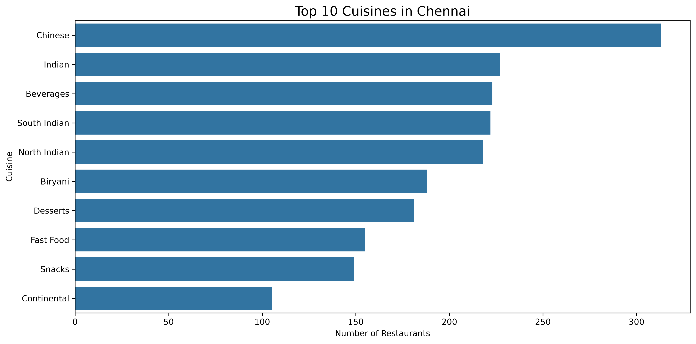
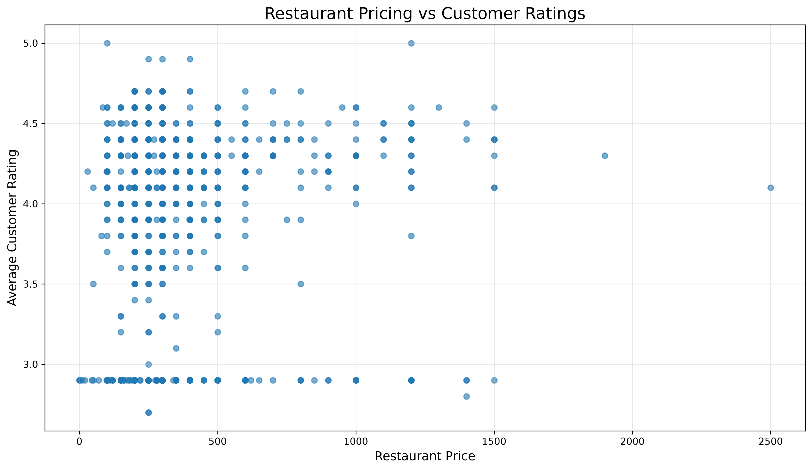
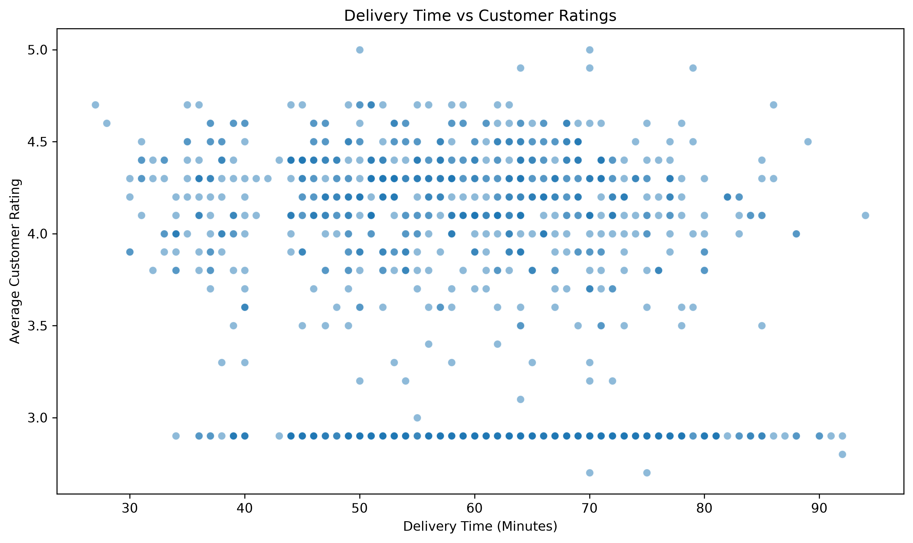
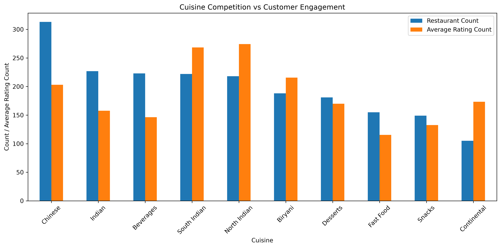
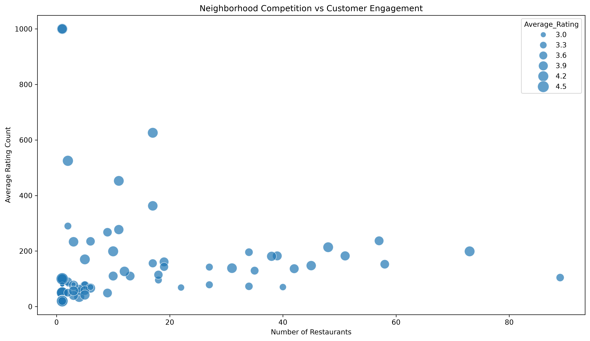

# Urban Food Delivery Analysis – Chennai

## Project Overview
This project focuses on analysing the urban food delivery and restaurant landscape in Chennai using Python. The objective is to explore restaurant distribution, cuisine preferences, pricing patterns, customer ratings, and neighbourhood-level competition.

The analysis helps understand the relationship between restaurant pricing, customer ratings, cuisine availability, and restaurant competition across different areas of Chennai.

## Dataset Overview
- **Total Records:** 1,106
- **Total Columns:** 10
- **Location:** Chennai, India

### Key Attributes
- Restaurant Name
- Area
- City
- Price
- Average Ratings
- Total Ratings
- Food Type / Cuisine
- Delivery Time
- Restaurant Address

## Tools & Technologies
- Python
- Pandas – Data cleaning and manipulation
- NumPy – Numerical operations
- Matplotlib – Data visualization
- Seaborn – Statistical visualization
- Jupyter Notebook – Analysis environment

## Project Workflow
1. Data loading and inspection
2. Data cleaning and preprocessing
3. Exploratory Data Analysis (EDA)
4. Cuisine distribution analysis
5. Restaurant pricing analysis
6. Customer ratings analysis
7. Neighbourhood competition analysis
8. Key insights and conclusions

## Visualizations

### 1. Top 10 Cuisines in Chennai

### 2. Restaurant Pricing vs Customer Ratings

### 3. Delivery Time vs Customer Ratings

### 4. Restaurant Competition Analysis

### 5. Neighbourhood Analysis

## Key Outcomes
The analysis explores:
- Popular cuisine categories across Chennai
- Restaurant pricing patterns
- The relationship between restaurant prices and customer ratings
- Competition among restaurants across neighbourhoods
- Differences in restaurant availability across areas

## Project Files
- Jupyter Notebook – Complete Python analysis
- PowerPoint Presentation – Project findings and visualizations
- Charts – Data visualizations
- Dataset – Source data used for analysis

## Conclusion
This project demonstrates the use of Python for real-world data analysis, including data cleaning, exploratory data analysis, and visualization. It helped develop practical skills in extracting insights from structured datasets and presenting findings in a business-oriented format.

---

**Author:** Kamesh  
**Project:** Urban Food Delivery Analysis – Chennai
